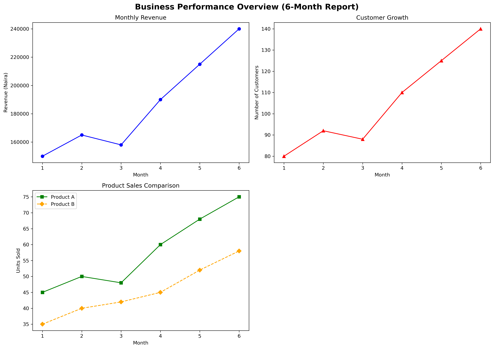

# Matplotlib Data Visualization Projects

A collection of hands-on data visualization exercises using **Python** and **Matplotlib**. This repository demonstrates practical charting techniques applied to real-world business scenarios across retail, marketing, healthcare, and general business analytics.

---

## Table of Contents

- [Overview](#overview)
- [Projects](#projects)
  - [Exercise 1: Retail Sales Trend Analysis](#exercise-1-retail-sales-trend-analysis)
  - [Exercise 2: Customer Acquisition Comparison](#exercise-2-customer-acquisition-comparison)
  - [Exercise 3: Healthcare Performance Dashboard](#exercise-3-healthcare-performance-dashboard)
  - [Mini Project: Business Performance Dashboard](#mini-project-business-performance-dashboard)
- [Technologies Used](#technologies-used)
- [Key Skills Demonstrated](#key-skills-demonstrated)
- [Installation](#installation)
- [Usage](#usage)
- [Project Structure](#project-structure)
- [Contributing](#contributing)
- [License](#license)
- [Contact](#contact)

---

## Overview

This repository showcases practical data visualization skills using Matplotlib. Each exercise focuses on creating clear, informative, and business-relevant charts, following a structured workflow:

1. **Data Preparation** — Defining and organizing the dataset
2. **Chart Selection** — Choosing the right chart type for the message
3. **Styling & Formatting** — Titles, labels, legends, and color choices
4. **Layout Management** — Subplots, grids, and dashboards
5. **Interpretation** — Extracting actionable insights from visuals

---

## Projects

### Exercise 1: Retail Sales Trend Analysis
**Domain:** Retail / Sales

**Objective:** Visualize monthly sales trends to identify growth patterns.

**Key Tasks:**
- Created a line chart with black dashed styling
- Added titles, axis labels, and markers for data points
- Set custom axis limits for focused visualization

**Key Insights:**
- Sales showed a general upward trend over six months
- A slight decline occurred in March, followed by consistent growth through June
- Chart highlights the March dip and the May–June surge for business investigation

---

### Exercise 2: Customer Acquisition Comparison
**Domain:** Marketing / Campaign Analytics

**Objective:** Compare the performance of two marketing campaigns over time.

**Key Tasks:**
- Plotted two line series on shared axes for direct comparison
- Used distinct colors (green vs red) and labels for clarity
- Created a side-by-side subplot comparison as a bonus challenge

**Key Insights:**
- Campaign A consistently outperformed Campaign B every month
- Both campaigns showed steady growth, with the gap widening in later months
- Subplots allow independent scaling for detailed per-campaign analysis

---

### Exercise 3: Healthcare Performance Dashboard
**Domain:** Healthcare / Hospital Operations

**Objective:** Track key hospital metrics across multiple dimensions.

**Key Tasks:**
- Created a vertically stacked 3-panel dashboard
- Plotted patient volume (blue), waiting time (red), and satisfaction (green)
- Used different markers (`o`, `s`, `^`) to distinguish each metric

**Key Insights:**
- Patient volume grew 28.6% (420 → 540) over six months
- Average waiting time decreased significantly (65 → 49 minutes)
- Patient satisfaction rose steadily (72 → 83)
- The hospital successfully managed higher volumes without compromising experience

**Bonus Analysis:**
- Explained why metrics with different scales (hundreds vs. tens vs. 0–100) require separate axes
- Distinguished correlation from causation in healthcare analytics

---

# Mini Project: Business Performance Visualization

## 1. Business Problem
A small business owner needs a clear, visual overview of their performance over the last six months. They want to understand revenue trends, customer growth, and how their two main products are performing to make informed, data-driven decisions.

## 2. Project Objectives
The goal of this project is to transform raw operational data into a structured visual report using Python. Specifically, the project aims to:
- Create a single figure containing multiple charts.
- Visualize monthly revenue trends.
- Visualize customer growth over time.
- Compare the sales performance of Product A and Product B.

## 3. Dataset Description
The dataset consists of six months of simulated business data. 
*   `months`: Reporting period (1 through 6).
*   `revenue`: Total monthly revenue in Naira.
*   `customers`: Total number of customers acquired each month.
*   `product_a` & `product_b`: Monthly sales quantities (units) for each product.

## 4. Tools and Libraries Used
*   **Python 3**
*   **Matplotlib:** Used for creating the line charts, styling, and organizing the subplot layout.
*   **Jupyter Notebook / Google Colab:** Used as the development environment.

## 5. Summary of the Charts Created
The final visualization is a 2x2 grid layout (with one empty space) containing three distinct charts:
1.  **Monthly Revenue Trend:** A line chart showing revenue growth over the 6 months.
2.  **Customer Growth:** A line chart showing the number of customers over the same period.
3.  **Product Performance Comparison:** A multi-line chart comparing Product A and Product B sales, featuring different line styles, colors, and a legend.



## 6. Key Observations
Based on the visual analysis of the data:
1.  **General Growth:** Both revenue and customer numbers show a strong upward trend over the six months. Revenue grew by 60% (from 150k to 240k Naira).
2.  **Correlated Dips:** There was a slight dip in Month 3. The charts reveal that this dip in revenue was accompanied by a dip in the number of customers, suggesting the revenue drop was volume-driven rather than a pricing issue.
3.  **Product Dominance:** Product A consistently outsold Product B in every single month, indicating it is the primary driver of sales volume.

## 7. Instructions for Running the Notebook
1. Clone this repository to your local machine.
2. Ensure you have Python and Matplotlib installed (`pip install matplotlib`).
3. Open the `business_performance.ipynb` file using Jupyter Notebook or upload it to Google Colab.
4. Run all cells sequentially to generate the visualization.

### Mini Project: Business Performance Dashboard
**Domain:** General Business Analytics

**Objective:** Build a comprehensive 2×2 dashboard summarizing key business metrics.

**Key Tasks:**
- Created a 2×2 grid layout with a master title (`fig.suptitle`)
- Plotted revenue, customer growth, and product comparison charts
- Used `axes[row, column]` indexing for precise placement
- Saved the dashboard as a high-resolution PNG (300 DPI)

**Key Insights:**
- Revenue grew from ₦150,000 to ₦240,000 (60% growth)
- Customer count doubled from 80 to 140
- Product A consistently outsold Product B every month
- Month 3 dip in both revenue and customers suggests customer-driven, not pricing-driven

---

## Technologies Used

| Technology | Purpose |
|------------|---------|
| **Python 3.13** | Programming language |
| **Matplotlib** | Data visualization and charting |
| **Jupyter Notebook** | Interactive development environment |

---

## Key Skills Demonstrated

### Basic Plotting
- `plt.plot()` — Line charts with markers and styles
- `plt.title()`, `plt.xlabel()`, `plt.ylabel()` — Labeling
- `plt.xlim()`, `plt.ylim()` — Axis range control
- `plt.legend()` — Multi-series identification

### Styling Techniques
- `color`, `linestyle`, `marker` — Line and point customization
- Marker types: `"o"` (circle), `"s"` (square), `"^"` (triangle), `"D"` (diamond)
- Line styles: `"--"` (dashed), `"-"` (solid)

### Subplots & Layouts
- `plt.subplots(nrows, ncols, figsize)` — Creating figure grids
- `axes[0]`, `axes[0, 1]` — Indexing subplots
- `axes.axis("off")` — Hiding unused panels
- `plt.tight_layout()` — Automatic spacing adjustment
- `fig.suptitle()` — Master title for multi-panel figures

### Saving Figures
- `plt.savefig(path, dpi=300, bbox_inches="tight")` — Exporting high-resolution charts

### Business Interpretation
- Distinguishing correlation from causation
- Identifying trends, dips, and anomalies
- Recommending follow-up data collection (marketing spend, AOV, retention)

  ---

  ### Porject Structure
  matplotlib-visualization-projects/
│
├── README.md
│
├── Exercise_1_Retail_Sales_Trend.ipynb
├── Exercise_2_Customer_Acquisition.ipynb
├── Exercise_3_Healthcare_Dashboard.ipynb
├── Mini_Project_Business_Dashboard.ipynb
│
├── images/
│   └── business_performance_charts.png
│
└── requirements.txt

---

## Installation

1. **Clone the repository:**
```bash
git clone https://github.com/yourusername/matplotlib-visualization-projects.git
cd matplotlib-visualization-projects
